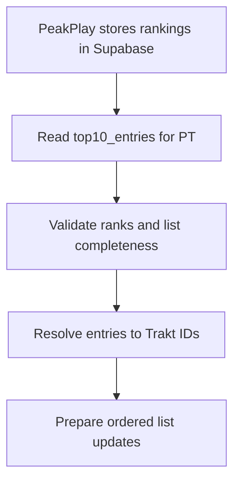
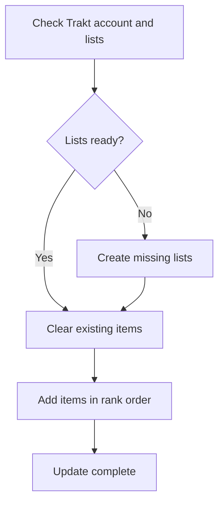

# API Documentation

This document describes the APIs used by the active Trakt synchronization workflow.

## 📡 Overview

The workflow reads ranking data from PeakPlay's Supabase project and uses Trakt for content matching and list management. PeakPlay separately collects FlixPatrol rankings and stores them in Supabase; this repository does not fetch FlixPatrol pages during a sync.

## 🗄️ PeakPlay Supabase

The sync reads the public `top10_entries` table through Supabase's REST endpoint:

```text
GET {SUPABASE_URL}/rest/v1/top10_entries
```

The request uses a read-only Supabase publishable key in the `apikey` header. For older projects, the legacy `anon` key is also supported. It selects `service`, `type`, `category`, `rank`, `title`, `tmdb_id`, `imdb_id`, and `year`, filtered by `SUPABASE_COUNTRY_CODE` (defaults to `PT`). The database's anonymous SELECT policy allows this read without a service-role key.

Rows are mapped as follows:

| Supabase fields | Trakt list |
| --- | --- |
| `netflix`, `movie`, `general` | Netflix Movies |
| `netflix`, `series`, `general` | Netflix Shows |
| `netflix`, `movie`, `kids` | Netflix Kids Movies (optional) |
| `netflix`, `series`, `kids` | Netflix Kids Shows (optional) |
| `hbo` / `apple` / `prime`, movie or series, `general` | Corresponding service and type list |
| `disney`, movie or series, `general` | Disney+ mixed list, ordered by rank |

Every required list must contain exactly ranks 1 through 10. A missing or partial list stops the run before any Trakt list is changed. The workflow also resolves all entries to Trakt IDs before it starts writing lists, so unmatched entries do not produce partial lists.

## 🎯 Trakt.tv API Integration

### Authentication

#### Device Code and Refresh Token Flow
The project uses Trakt's Device Code Flow for its one-time sign-in. Trakt recommends this flow for command-line tools and system services; it does not need a callback URL or Client Secret.

1. Request a device code with `POST https://api.trakt.tv/oauth/device/code` and body `{"client_id": "..."}`.
2. Show the returned `verification_url` and `user_code` to the user.
3. Poll `POST https://api.trakt.tv/oauth/device/token` at the returned `interval`, with body `{"code": "device_code_value", "client_id": "..."}`. Stop after `expires_in` or when the user declines.
4. Store the returned `access_token` and `refresh_token` securely. Access tokens last 7 days.

The scheduled workflow renews the access token with `POST https://api.trakt.tv/oauth/token`:

```json
{
    "refresh_token": "refresh_token_value",
    "client_id": "client_id_value",
    "grant_type": "refresh_token"
}
```

Successful refreshes rotate the refresh token: Trakt invalidates the submitted token immediately. The workflow therefore writes both returned tokens back to GitHub Actions secrets before dispatching the Trakt sync. Do not reuse an old refresh token after a successful refresh.

#### Request Headers
```python
headers = {
    'Content-Type': 'application/json',
    'Authorization': f'Bearer {ACCESS_TOKEN}',
    'trakt-api-version': '2',
    'trakt-api-key': CLIENT_ID,
    'User-Agent': "Mozilla/5.0 (Macintosh; Intel Mac OS X 10_15_7) AppleWebKit/537.36 (KHTML, like Gecko) Chrome/130.0.0.0 Safari/537.36"
}
```

### Core Endpoints

#### 1. Token Validation
```http
GET https://api.trakt.tv/users/settings
```
- **Purpose**: Validate current access token
- **Response**: User settings if token is valid, 401 if invalid

#### 2. Content Search
```http
GET https://api.trakt.tv/search/movie?query={title}&year={year}
GET https://api.trakt.tv/search/show?query={title}&year={year}
```
- **Purpose**: Find Trakt IDs for movies/shows
- **Parameters**:
  - `query`: Movie/show title (URL encoded)
  - `year`: Release year (optional, for disambiguation)

**Response Example**:
```json
[
    {
        "type": "movie",
        "score": 100.0,
        "movie": {
            "title": "Movie Title",
            "year": 2023,
            "ids": {
                "trakt": 12345,
                "slug": "movie-title-2023",
                "imdb": "tt1234567",
                "tmdb": 67890
            }
        }
    }
]
```

#### 3. List Management

##### Get User Lists
```http
GET https://api.trakt.tv/users/me/lists
```

##### Create List
```http
POST https://api.trakt.tv/users/me/lists
```
**Request Body**:
```json
{
    "name": "Top Portugal Netflix Movies",
    "description": "List that contains the top 10 movies on Netflix Portugal right now, updated daily",
    "privacy": "public",
    "display_numbers": true
}
```

##### Update List Items
```http
POST https://api.trakt.tv/users/me/lists/{slug}/items
```
**Request Body**:
```json
{
    "movies": [
        {"ids": {"trakt": 12345}},
        {"ids": {"trakt": 67890}}
    ],
    "shows": [
        {"ids": {"trakt": 11111}},
        {"ids": {"trakt": 22222}}
    ]
}
```

##### Remove All Items
```http
POST https://api.trakt.tv/users/me/lists/{slug}/items/remove
```
**Request Body**:
```json
{
    "movies": [{"ids": {"trakt": 0}}],
    "shows": [{"ids": {"trakt": 0}}]
}
```

### Rate Limiting

Trakt API implements rate limiting:
- **Limit**: 1000 requests per 5-minute window
- **Headers**: Response includes rate limit headers
- **Handling**: Project implements retry logic with exponential backoff

```python
@retry_request
def api_call():
    # Implementation includes automatic retry on rate limit (429) responses
    pass
```

## 🔄 Data Flow

### 1. Content Discovery


### 2. List Synchronization


### Data Transformation

#### Supabase → Trakt Mapping
```python
# Supabase row
{"service": "netflix", "type": "movie", "category": "general",
 "rank": 1, "title": "Inception", "tmdb_id": 27205}

# Trakt list item after content matching
{"movies": [{"ids": {"trakt": 16662}}]}
```

## 🛠️ Implementation Details

### Error Handling

#### Network Errors
```python
try:
    response = requests.get(url, headers=headers)
    response.raise_for_status()
except requests.exceptions.RequestException as e:
    logging.error(f"Network error: {e}")
    return None
```

#### API Errors
```python
if response.status_code == 401:
    logging.error("Authentication failed - check tokens")
elif response.status_code == 429:
    logging.warning("Rate limited - retrying after delay")
elif response.status_code >= 500:
    logging.error("Server error - retrying")
```

### Retry Logic
```python
def retry_request(func):
    """Decorator for retrying API requests with exponential backoff"""
    @wraps(func)
    def wrapper(*args, **kwargs):
        for attempt in range(3):
            try:
                result = func(*args, **kwargs)
                if result.status_code < 500:
                    return result
            except Exception as e:
                if attempt == 2:  # Last attempt
                    raise e
                time.sleep(2 ** attempt)  # Exponential backoff
        return None
    return wrapper
```

### Content Matching Logic

#### Title Normalization
```python
def normalize_title(title):
    """Normalize titles for better matching"""
    # Remove common variations
    title = re.sub(r'\s*\([^)]*\)', '', title)  # Remove parentheses
    title = re.sub(r'\s*:\s*', ' ', title)      # Normalize colons
    return title.strip()
```

#### Year Extraction
```python
def extract_year(title_tag):
    """Extract year from FlixPatrol title tag"""
    year_match = re.search(r'-(\d{4})(?:-|$)', title_tag)
    return int(year_match.group(1)) if year_match else None
```

## 📊 List Configurations

### Trakt List Definitions
```python
# Netflix Lists
NETFLIX_LISTS = {
    "movies": {
        "name": "Top Portugal Netflix Movies",
        "slug": "top-portugal-netflix-movies",
        "description": "Top 10 movies on Netflix Portugal, updated daily"
    },
    "shows": {
        "name": "Top Portugal Netflix Shows", 
        "slug": "top-portugal-netflix-shows",
        "description": "Top 10 TV shows on Netflix Portugal, updated daily"
    }
}

# Similar structures for HBO, Disney+, Apple TV+, Prime Video
```

### List Update Strategy
1. **Atomic Updates**: Clear existing items before adding new ones
2. **Ranking Preservation**: Items are added in ranked order
3. **Error Recovery**: Failed updates don't leave lists in partial state
4. **Logging**: Comprehensive logging for debugging and monitoring

## 🔍 Debugging and Monitoring

### Debug Mode
```bash
# Enable debug output
PRINT_LISTS=True python top_pt_stream_services.py
```

### API Response Logging
```python
# Log API responses for debugging
logging.debug(f"Trakt search response: {response.json()}")
logging.debug(f"List update payload: {payload}")
```

### Health Checks
```python
# Validate token before processing
token_status = check_token()
if not token_status:
    logging.error("Invalid token - exiting")
    return -1
```

## 🚨 Error Codes

### Common HTTP Status Codes
- `200`: Success
- `201`: Created (successful list creation)
- `401`: Unauthorized (invalid token)
- `404`: Not found (list or content not found)
- `429`: Too Many Requests (rate limited)
- `500`: Internal Server Error (API issue)

### Custom Return Codes
- `0`: Success
- `-1`: Authentication failure
- `304`: No changes needed (empty payload)

---

This API documentation provides the foundation for understanding and extending the Top Streaming Services Data Portugal project. For additional details, refer to the [Trakt API Authentication guide](https://developer.trakt.tv/docs/authentication-oauth) and examine the source code.