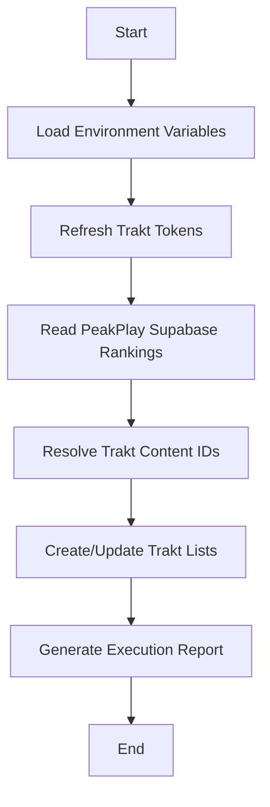

# Top Streaming Services Data Portugal 🇵🇹

> ✅ **Trakt API access is free on the Standard tier.** New API apps require a verified GitHub account connected to the Trakt developer portal. Run `python authorize_trakt.py` once to connect your Trakt account, then add the generated tokens to GitHub Actions secrets to enable scheduled updates.

[](https://github.com/pcarrasqueira/top-streaming-services-data-portugal/actions)
[](https://www.python.org/downloads/)

A Python automation tool that reads the latest Portugal rankings collected by PeakPlay in Supabase and syncs the top 10 lists to [Trakt.tv](https://trakt.tv/). PeakPlay owns the FlixPatrol collection pipeline; this project reads its stored rankings and handles Trakt matching and list updates.

## 🎯 Overview

Stay connected with Portugal's streaming trends! This automation tool:

- 📊 **Reads PeakPlay Rankings**: Netflix, HBO Max, Disney+, Apple TV+, and Amazon Prime Video from Supabase
- 🔄 **Auto-Sync to Trakt**: Creates and maintains public Trakt lists with trending content
- ⏰ **Automated Updates**: Syncs the latest Supabase rankings to Trakt via GitHub Actions
- 🎬 **Comprehensive Coverage**: Movies, TV shows, and optional kids content
- 🔒 **Secure**: Uses OAuth token refresh for reliable Trakt API access

## ✨ Features

### Core Functionality
- **Supabase Data Source**: Reads ranked entries already collected by PeakPlay
- **Intelligent Content Matching**: Uses stored TMDB IDs and Trakt search to identify movies and shows
- **Dynamic List Management**: Creates, updates, and maintains Trakt lists with proper rankings
- **Error Handling**: Robust retry mechanisms and comprehensive logging
- **Token Management**: Automatic OAuth token refresh for uninterrupted operation

### Supported Streaming Services
- 🔴 **Netflix**: Movies, TV Shows, Kids Movies, Kids TV Shows
- 🟣 **HBO Max**: Movies, TV Shows  
- 🔵 **Disney+**: Overall top content (mixed movies and shows)
- 🍎 **Apple TV+**: Movies, TV Shows
- 📦 **Amazon Prime Video**: Movies, TV Shows

### Generated Trakt Lists
All lists are public and automatically updated with current rankings:
- Top Portugal Netflix Movies
- Top Portugal Netflix Shows  
- Top Portugal Netflix Kids Movies (optional)
- Top Portugal Netflix Kids Shows (optional)
- Top Portugal HBO Movies
- Top Portugal HBO Shows
- Top Portugal Disney+ (mixed content)
- Top Portugal Apple TV Movies
- Top Portugal Apple TV Shows
- Top Portugal Amazon Prime Movies
- Top Portugal Amazon Prime Shows

## 🚀 Quick Start

**For detailed setup instructions, see the [📚 Setup Guide](SETUP.md)**

### Prerequisites

- **Python 3.13+** (or 3.x compatible)
- **Trakt.tv Account** with API application registered
- **GitHub Account** (for automated execution via Actions)

### Installation

1. **Clone the repository**
   ```bash
   git clone https://github.com/pcarrasqueira/top-streaming-services-data-portugal.git
   cd top-streaming-services-data-portugal
   ```

2. **Install dependencies**
   ```bash
   pip install -r requirements.txt
   ```

3. **Set up Trakt API credentials** (see [Configuration](#-configuration) section or [Setup Guide](SETUP.md))

4. **Run the script**
   ```bash
   python top_pt_stream_services.py
   ```

## ⚙️ Configuration

### Environment Variables

Create a `.env` file in the project root with the following variables:

```env
# Trakt API Credentials (Required)
CLIENT_ID=your_trakt_client_id
ACCESS_TOKEN=your_trakt_access_token
REFRESH_TOKEN=your_trakt_refresh_token

# PeakPlay Supabase (read-only)
SUPABASE_URL=https://your-project.supabase.co
SUPABASE_PUBLISHABLE_KEY=sb_publishable_your_key
SUPABASE_COUNTRY_CODE=PT

# Optional Settings
KIDS_LIST=True          # Include Netflix kids content (default: False)
PRINT_LISTS=False       # Print loaded rankings to console (default: False)
```

### Trakt API Setup

1. **Create a Trakt API app** at [Trakt Developer — My Apps](https://developer.trakt.tv/apps). Standard API access is free; app registration requires a verified GitHub account connected to the developer portal.
2. Put the app's **Client ID** in `.env` as `CLIENT_ID=...`.
3. Run `python authorize_trakt.py`. The helper uses Trakt's device-code flow, asks you to approve the app in a browser, saves the returned tokens securely in `.env`, and validates the access token. No Client Secret or redirect URI is needed.
4. For GitHub Actions, copy `CLIENT_ID`, `ACCESS_TOKEN`, and `REFRESH_TOKEN` into repository Actions secrets. Also configure `GH_PAT` so scheduled runs can store each rotated refresh token.

## 🔧 Usage

### Manual Execution

Run the script manually for immediate updates:

```bash
# Basic execution
python top_pt_stream_services.py

# With environment variables
CLIENT_ID=your_id ACCESS_TOKEN=your_token python top_pt_stream_services.py

# Enable debug output
PRINT_LISTS=True python top_pt_stream_services.py
```

### Automated Execution

The token workflow runs on its configured schedule, then dispatches the Trakt sync workflow. The sync reads the latest entries from PeakPlay's Supabase `top10_entries` table; PeakPlay updates that table independently.

You can also trigger manual runs:
1. Go to the "Actions" tab in your GitHub repository
2. Select "Sync Trakt Lists from PeakPlay" workflow
3. Click "Run workflow"

## 📋 Requirements

### Python Dependencies
- `requests` - HTTP requests to Supabase and Trakt APIs
- `beautifulsoup4` - Required only by the retained legacy FlixPatrol diagnostic utilities
- `python-dotenv` - Environment variable management

### System Requirements  
- Python 3.13+ (recommended) or 3.x compatible
- Internet connection for Supabase and Trakt API access
- GitHub account (for automated execution)

## 🛠️ How It Works

### Architecture Overview

The project uses a focused sync pipeline that reads PeakPlay rankings and writes matched entries to Trakt:

#### Core Components
- **`Config` Class**: Centralized configuration for Supabase, Trakt, timeouts, and environment variables
- **`StreamingServiceTracker` Class**: Main business logic encapsulation with error handling and reporting
- **Helper Functions**: Supabase loading, Trakt matching, ordered list updates, and reporting

#### Runtime Steps
1. **Configuration Loading**: Environment variables and settings initialization
2. **Data Loading**: Read Portugal rankings from PeakPlay Supabase and validate all required top-10 lists
3. **Content Identification**: Intelligent matching with Trakt.tv database using search API
4. **Authentication**: Automatic token validation and refresh
5. **List Management**: Create, update, and maintain Trakt lists with proper error recovery
6. **Reporting**: Execution summary with success/failure metrics

### Execution Flow



## 📊 Data Sources

- **PeakPlay Supabase**: Stored streaming rankings and TMDB/IMDb identifiers
- **Trakt.tv**: Content matching and list management
- **FlixPatrol**: Upstream ranking source collected by PeakPlay; this project does not scrape it
- **GitHub Actions**: Automation and scheduling platform

## 🔒 Security & Quality

### Security Features
- **Request Timeouts**: All HTTP requests include timeout protection to prevent hanging
- **Environment Variables**: Sensitive data (API keys, tokens) stored securely, never hardcoded
- **Error Handling**: Comprehensive exception handling for network failures and API issues
- **Token Management**: Automatic OAuth token refresh with secure credential updates

### Code Quality
- **Type Hints**: Full type annotation coverage for better development experience
- **PEP 8 Compliance**: Automated code formatting and style checking
- **Security Scanning**: Bandit security analysis with zero issues
- **Pre-commit Hooks**: Automated quality checks before commits
- **CI/CD Pipeline**: Continuous integration with code quality gates

### Quality Metrics
- ✅ **0 Security Issues** (Bandit scan)
- ✅ **0 Style Violations** (Flake8 check)
- ✅ **100% Type Coverage** (Public functions)
- ✅ **Automated Quality Checks** (CI/CD pipeline)

## 🐛 Troubleshooting

### Common Issues

#### Authentication Errors
```
Error: Invalid access token
```
**Solution**: GitHub Actions refreshes the token before each Trakt sync. If a refresh fails with `invalid_grant`, run `python authorize_trakt.py` again and replace the `CLIENT_ID`, `ACCESS_TOKEN`, and `REFRESH_TOKEN` repository secrets. For local runs, the helper renews credentials in `.env` when you authorize again.

#### Missing Content
```
Warning: Payload is empty. No items to add on list
```
**Solution**: Check the logs for incomplete Supabase rankings or entries that could not be matched on Trakt.

#### Rate Limiting
```
Error: Too many requests
```
**Solution**: The script includes retry logic, but if you're hitting rate limits, ensure you're not running multiple instances simultaneously.

### Debug Mode

Enable detailed logging by setting:
```bash
PRINT_LISTS=True python top_pt_stream_services.py
```

### GitHub Actions Issues

1. **Secret Configuration**: Ensure all required secrets are properly set in repository settings
2. **Token Refresh**: Check that `GH_PAT` has permission to update repository secrets
3. **Workflow Permissions**: Verify Actions have necessary permissions in repository settings

## 🤝 Contributing

**For detailed contributing guidelines, see [CONTRIBUTING.md](CONTRIBUTING.md)**

We welcome contributions! Here's how you can help:

### Reporting Issues
- Use GitHub Issues to report bugs or request features
- Provide detailed information including error messages and logs
- Include your Python version and environment details

### Code Contributions

1. **Fork the repository**
2. **Create a feature branch**
   ```bash
   git checkout -b feature/your-feature-name
   ```
3. **Make your changes**
   - Follow existing code style
   - Add comments for complex logic
   - Update documentation if needed
4. **Test your changes**
   ```bash
   python top_pt_stream_services.py
   ```
5. **Commit and push**
   ```bash
   git commit -m "Add your feature description"
   git push origin feature/your-feature-name
   ```
6. **Create a Pull Request**

### Development Guidelines

- **Code Style**: Follow PEP 8 guidelines
- **Error Handling**: Add appropriate try-catch blocks
- **Logging**: Use the existing logging framework
- **Documentation**: Update README and code comments
- **Testing**: Ensure changes don't break existing functionality

## 📚 API Reference

**For comprehensive API documentation, see [API.md](API.md)**

### Supabase Data Endpoint

The sync reads `top10_entries` from PeakPlay's Supabase project, filtered by country and ordered by service, category, type, and rank. Configure `SUPABASE_URL`, `SUPABASE_PUBLISHABLE_KEY`, and optionally `SUPABASE_COUNTRY_CODE`.

### Trakt API Endpoints

- **Authentication**: `https://api.trakt.tv/oauth/token`
- **Search**: `https://api.trakt.tv/search/movie` and `https://api.trakt.tv/search/show`
- **Lists**: `https://api.trakt.tv/users/me/lists/`
- **List Items**: `https://api.trakt.tv/users/me/lists/{slug}/items`

### Data Structures

#### Loaded Content Format
```python
[
    ("1", "Movie Title", "", "2024", "", "12345", "tt1234567", "movie"),
    # rank, title, slug, year, starring, tmdb_id, imdb_id, media_type
]
```

#### Trakt Payload Format
```python
{
    "movies": [
        {"ids": {"trakt": 12345}},
        ...
    ],
    "shows": [
        {"ids": {"trakt": 67890}},
        ...
    ]
}
```

## 📚 Documentation

This project includes comprehensive documentation to help you get started and contribute effectively:

- **[🚀 Setup Guide](SETUP.md)** - Complete step-by-step installation and configuration instructions
- **[📡 API Documentation](API.md)** - Supabase and Trakt API usage
- **[🤝 Contributing Guidelines](CONTRIBUTING.md)** - How to contribute to the project, coding standards, and development workflow
- **[👨‍💻 Developer Guide](DEVELOPER.md)** - Architecture overview, development setup, and coding guidelines
- **[📋 Changelog](CHANGELOG.md)** - Project version history, new features, and changes

For quick reference:
- **Installation**: See [SETUP.md](SETUP.md) for detailed setup instructions
- **API Reference**: Check [API.md](API.md) for technical implementation details
- **Contributing**: Read [CONTRIBUTING.md](CONTRIBUTING.md) before submitting pull requests
- **Development**: See [DEVELOPER.md](DEVELOPER.md) for architecture and coding guidelines
- **Updates**: Track changes in [CHANGELOG.md](CHANGELOG.md)

## 📞 Support

- **GitHub Issues**: [Create an issue](https://github.com/pcarrasqueira/top-streaming-services-data-portugal/issues)
- **Discussions**: [Join the discussion](https://github.com/pcarrasqueira/top-streaming-services-data-portugal/discussions)
- **Trakt API Docs**: [Authentication](https://developer.trakt.tv/docs/authentication-oauth) · [PKCE](https://developer.trakt.tv/docs/pkce)

---

**Last Updated**: 2024
**Maintainer**: [pcarrasqueira](https://github.com/pcarrasqueira)

*This project is not affiliated with FlixPatrol, Trakt.tv, or any streaming service mentioned.*
  
